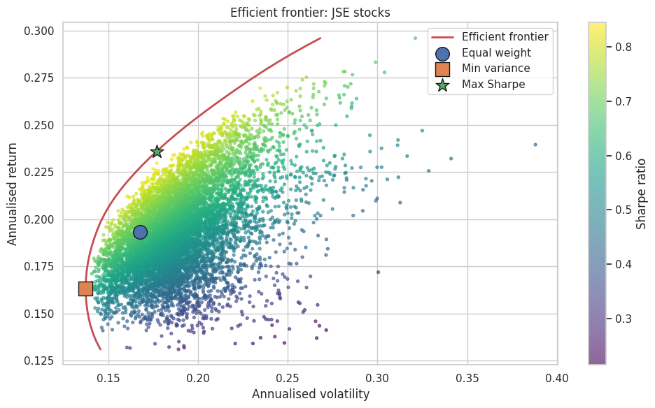
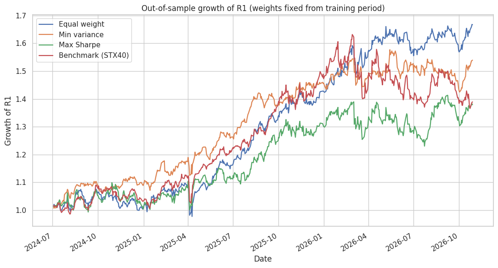
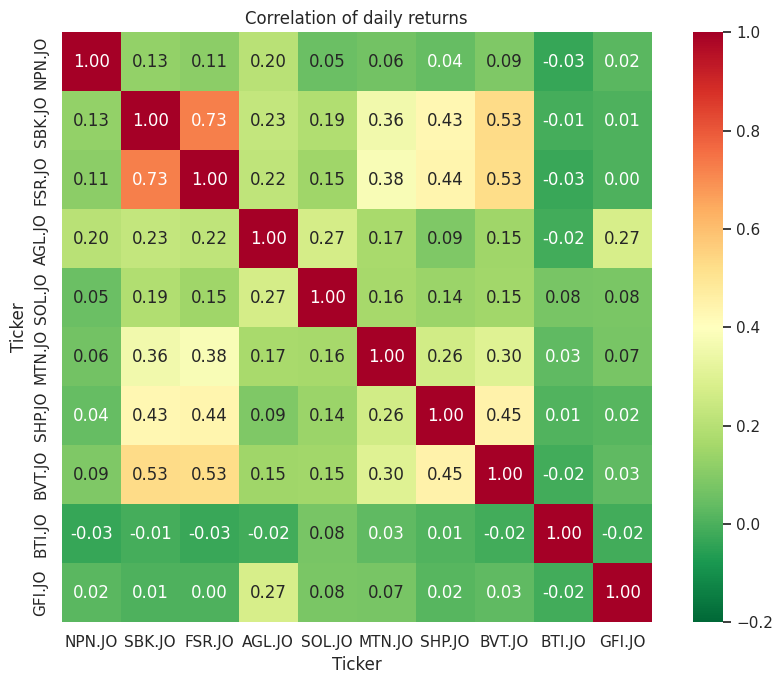

# JSE Portfolio Risk & Return Analysis

**Question:** Does mean-variance optimisation beat a simple equal-weight portfolio of JSE stocks when tested on data the optimiser has not seen?

**Headline finding:** Over the out-of-sample period (Jul 2024 to Oct 2026), a plain equal-weight portfolio of 10 JSE stocks delivered the best risk-adjusted return (Sharpe 1.12), ahead of the minimum-variance portfolio (0.99), the maximum-Sharpe portfolio (0.39) and the Satrix 40 benchmark (0.43). The maximum-Sharpe portfolio looked best on the data it was fitted to (Sharpe 0.86) but did not hold up on unseen data.

## What this project does
- Pulls daily prices (Jan 2021 to 28 Oct 2026, about 5.8 years) for 10 JSE stocks plus the Satrix 40 ETF (STX40) as a Top 40 proxy
- Computes annualised return, volatility, Sharpe ratio, correlation, beta, historical VaR and max drawdown
- Builds equal-weight, minimum-variance and maximum-Sharpe long-only portfolios (max 40% per stock)
- Plots the efficient frontier
- Trains the optimiser on the first 60% of the data (5 Jan 2021 to 2 Jul 2024) and tests the frozen weights on the last 40% (3 Jul 2024 to 28 Oct 2026)

**Stocks:** NPN, SBK, FSR, AGL, SOL, MTN, SHP, BVT, BTI, GFI. **Risk-free rate:** 8% p.a. (assumption). **Data end date:** fixed at 28 Oct 2026 so results are reproducible.

## Individual stock statistics (full sample)
| Stock | Ann. return | Ann. volatility | Sharpe |
|---|---|---|---|
| SHP | 18.05% | 24.34% | 0.41 |
| MTN | 22.33% | 35.96% | 0.40 |
| GFI | 26.96% | 49.37% | 0.38 |
| SBK | 16.91% | 25.70% | 0.35 |
| FSR | 11.43% | 25.90% | 0.13 |
| SOL | 14.53% | 51.04% | 0.13 |
| BTI | 10.96% | 23.24% | 0.13 |
| AGL | 9.40% | 38.93% | 0.04 |
| BVT | 7.93% | 25.49% | 0.00 |
| NPN | 2.26% | 42.16% | -0.14 |

## Results (out-of-sample, weights fixed from the training period)
| Strategy | Ann. return | Ann. volatility | Sharpe | Max drawdown |
|---|---|---|---|---|
| Equal weight | 24.77% | 14.99% | 1.12 | -11.18% |
| Min variance | 20.54% | 12.65% | 0.99 | -9.65% |
| Max Sharpe | 14.93% | 17.82% | 0.39 | -11.46% |
| Benchmark (STX40) | 15.30% | 16.93% | 0.43 | -16.30% |

## The overfitting gap: in-sample vs out-of-sample
In-sample results (training period, 5 Jan 2021 to 2 Jul 2024, the data the weights were fitted on):

| Strategy | Ann. return | Ann. volatility | Sharpe | Max drawdown |
|---|---|---|---|---|
| Equal weight | 16.33% | 17.86% | 0.47 | -15.31% |
| Min variance | 14.25% | 14.54% | 0.43 | -9.75% |
| Max Sharpe | 24.87% | 19.58% | 0.86 | -15.12% |

| Strategy | Sharpe in-sample | Sharpe out-of-sample |
|---|---|---|
| Equal weight | 0.47 | 1.12 |
| Min variance | 0.43 | 0.99 |
| Max Sharpe | 0.86 | 0.39 |

Max Sharpe ranked first in-sample and last out-of-sample. Because the test period was stronger for every portfolio, the fairest comparison is relative to equal weight, which involves no fitting: max Sharpe led equal weight by 0.39 Sharpe points in-sample and trailed it by 0.73 out-of-sample.

## Risk measures (out-of-sample)
| Strategy | Beta vs STX40 | Daily VaR 95% (historical) |
|---|---|---|
| Equal weight | 0.69 | -1.36% |
| Min variance | 0.41 | -1.28% |
| Max Sharpe | 0.79 | -1.74% |
| Benchmark (STX40) | 1.00 | -1.62% |

Max Sharpe has a beta below 1 but a worse VaR and higher volatility than the benchmark: beta captures only market-linked risk, and the portfolio carries concentrated stock-specific risk.

## Portfolio weights
### Fitted on the training period (used in the out-of-sample test)
| Stock | Equal weight | Min variance | Max Sharpe |
|---|---|---|---|
| NPN | 10.0% | 7.0% | 6.2% |
| SBK | 10.0% | 7.7% | 10.1% |
| FSR | 10.0% | 6.9% | 0.0% |
| AGL | 10.0% | 2.9% | 0.0% |
| SOL | 10.0% | 0.0% | 0.0% |
| MTN | 10.0% | 2.3% | 0.0% |
| SHP | 10.0% | 15.3% | 40.0% |
| BVT | 10.0% | 11.6% | 21.9% |
| BTI | 10.0% | 38.5% | 0.0% |
| GFI | 10.0% | 7.9% | 21.9% |

In training, max Sharpe held only five stocks, with SHP at the 40% cap.

### Fitted on the full sample (for illustration)
| Stock | Equal weight | Min variance | Max Sharpe |
|---|---|---|---|
| NPN | 10.0% | 8.2% | 0.3% |
| SBK | 10.0% | 6.1% | 11.9% |
| FSR | 10.0% | 7.1% | 0.0% |
| AGL | 10.0% | 4.2% | 0.0% |
| SOL | 10.0% | 0.9% | 7.4% |
| MTN | 10.0% | 2.8% | 17.3% |
| SHP | 10.0% | 17.3% | 24.0% |
| BVT | 10.0% | 11.3% | 0.0% |
| BTI | 10.0% | 36.0% | 17.6% |
| GFI | 10.0% | 6.3% | 21.5% |

Max Sharpe's weights were unstable: BTI and MTN went from 0% in training to about 17% each once the later data were included. Minimum variance barely moved (BTI 38.5% to 36.0%).

## Key takeaways
1. **Simple beat sophisticated.** Equal weight had the highest return and the highest Sharpe out-of-sample. Maximum Sharpe, the "optimal" portfolio on paper, did slightly worse than the benchmark (0.39 vs 0.43): it had the best Sharpe in-sample (0.86) and the worst out-of-sample (0.39), the classic signature of overfitting. This is consistent with published research showing that 1/N is hard to beat out-of-sample, because optimisers amplify errors in historical return estimates.
2. **Minimum variance was the safest.** It had the lowest volatility (12.65%) and the smallest drawdown (-9.65%) while still returning 20.54%. It relies on the covariance matrix only, not on return forecasts, which are the noisiest input.
3. **Diversification was real but uneven.** Standard Bank and FirstRand were the most correlated pair (0.73), and Bidvest, Shoprite and MTN also moved with the banks (about 0.3 to 0.5), which suggests a shared South African domestic-economy factor. BTI, GFI and Naspers had near-zero correlation with most other stocks, which is where much of the diversification benefit comes from.

## Data quality
- One corrupted price tick (a spike to near zero) in SBK.JO and one in STX40.JO were detected with a 5-day rolling-median filter (more than 40% deviation) and replaced with the previous day's price. Without this fix, SBK's volatility showed as over 5,000%.
- CFR.JO was replaced with BVT.JO because Yahoo Finance history for CFR only starts in April 2023, which would have cut the sample to 3.5 years.
- The data end date is fixed (28 Oct 2026) because Yahoo's latest day can be an unfinished trading day, which changed results slightly between runs.
- Sanity check: the benchmark and the equal-weight portfolio both had their worst out-of-sample day on 4 April 2025 (-4.83% and -5.45%), so the April 2025 dip appears in several series at once and looks like a market-wide move, not a data error.
- Prices are dividend- and split-adjusted. Yahoo quotes JSE prices in cents, which does not affect returns.

## Limitations
- One train/test split and a test window of about 2.3 years that includes a strong market run-up, so the ranking could differ in other periods. Over that short a window, the gap between equal weight (1.12) and minimum variance (0.99) is well within statistical noise.
- Equal weight's result may partly reflect a few strong performers in the test window (for example GFI); a stock-by-stock contribution analysis would test this
- Survivorship bias: the stocks are current Top 40 members, so companies that fell out of the index are missing
- Static weights, no transaction costs or taxes, constant risk-free rate, small stock universe
- STX40 is an ETF proxy for the Top 40, not the index itself
- The optimiser uses arithmetic mean returns as inputs, while the reported return and Sharpe figures use compound (geometric) returns, so the efficient frontier chart shows higher returns than the stock table

## Next steps
Rolling-window rebalancing backtest, shrinkage covariance (Ledoit-Wolf), CAPM alpha/beta regression, contribution analysis by stock.

## Concepts covered (CFA Level 1)
Quantitative Methods: return measures, descriptive statistics, correlation, sampling and biases. Portfolio Management: risk and return, diversification, Sharpe ratio, efficient frontier, capital allocation, CAPM beta.

## Run it
Open `jse_portfolio_analysis.ipynb` in Google Colab and choose Runtime > Run all.

## Tech
Python, pandas, NumPy, SciPy, matplotlib, seaborn, yfinance
